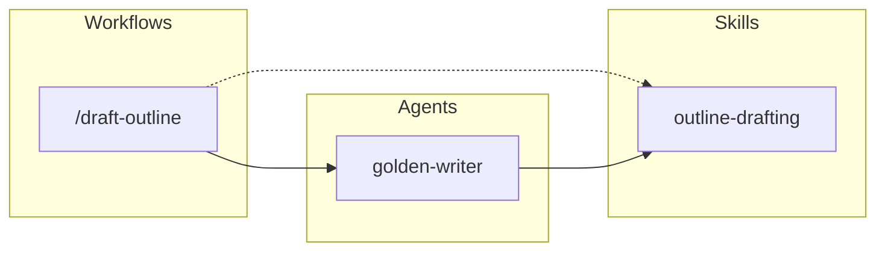

# AG Kit Dependency Graph

> Generated by `.agents/scripts/dependency_graph.py`. Do not edit manually.

Kit version: `2026.10.14` · 1 agents · 1 skills · 1 workflows

## Contracts

- `componentApi`: `1.0.0`
- `memorySchema`: `1.0.0`
- `rulesApi`: `1.0.0`
- `workflowApi`: `1.0.0`
